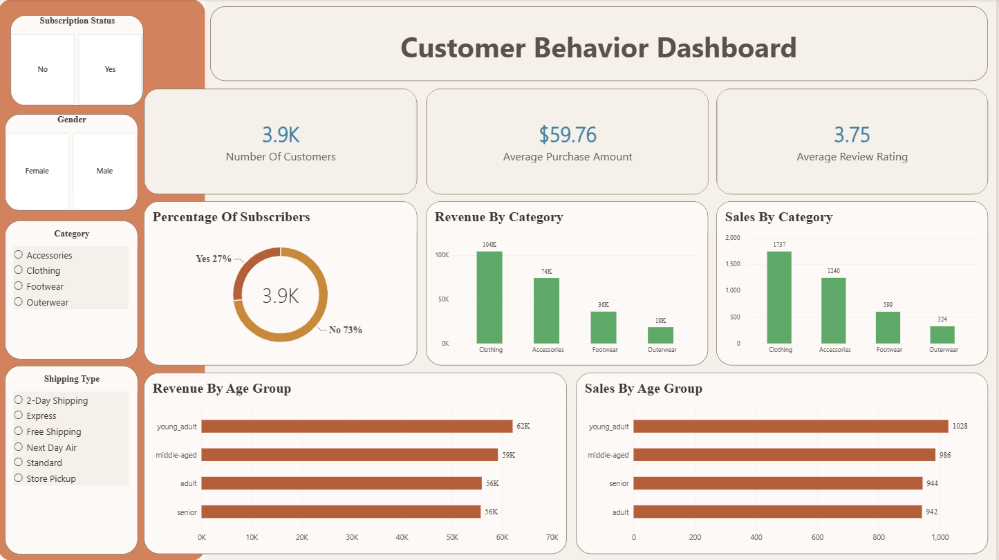

# Customer Shopping Behavior Analysis

An end-to-end data analysis project exploring customer purchases, product preferences, discounts, shipping choices, and subscription behavior. The project uses Python and pandas for data preparation and PostgreSQL for analysis, with results presented in a dashboard.

## Project Overview

The goal of this project is to turn customer shopping data into clear summaries that can help a retail business understand purchasing patterns. The analysis covers customer demographics, product categories, purchase amounts, review ratings, discounts, subscriptions, and shipping methods.

The dataset contains **3,900 purchase records** and **18 original fields**. It includes customer and transaction attributes such as age, gender, product, category, purchase amount, review rating, subscription status, shipping type, discount usage, and purchase history.

## Questions Explored

The SQL analysis examines questions including:

- How does revenue compare across genders?
- Which customers used discounts and spent more than the average purchase amount?
- Which products have the highest average review ratings?
- How do average purchase amounts compare between Standard and Express shipping?
- How do average spend and total revenue compare between subscribers and non-subscribers?
- Which products have the highest share of discounted purchases?
- How many customers fall into New, Returning, and Loyal purchase-history segments?
- What are the three most frequently purchased products in each category?
- Are repeat buyers more likely to subscribe?
- How is revenue distributed across age groups?

## Data Preparation

The notebook uses pandas to inspect and prepare the data for analysis. It fills missing review ratings with the median rating for each product category, standardizes column names, and creates age-group and purchase-frequency features.

In the supplied dataset, `Promo Code Used` and `Discount Applied` contain identical values, so the duplicate field is removed during preparation. Purchase-frequency labels are also mapped to approximate day values for easier comparison.

## Tools

- **Python and pandas** for data inspection, cleaning, and feature engineering
- **PostgreSQL** for business-focused queries
- **Jupyter Notebook** for the analysis workflow
- **Dashboard screenshot** for a visual summary of selected results

## Repository Contents

- `notebooks/customer_shopping_behavior_analysis.ipynb` — data preparation and optional PostgreSQL loading
- `sql/customer_behavior_analysis.sql` — queries for the ten analysis questions
- `data/raw/customer_shopping_behavior.csv` — source dataset
- `images/dashboard.png` — dashboard screenshot
- `questions.txt` — analysis questions
- `requirements.txt` — Python dependencies

## Data and Interpretation Notes

This project is an educational analysis of a shopping behavior dataset. The dataset resembles the [Shopping Behaviour Dataset on Kaggle](https://www.kaggle.com/datasets/saadaliyaseen/shopping-behaviour-dataset), though its provenance and reuse terms were not included with the supplied files. Please confirm the dataset license before redistributing it.
